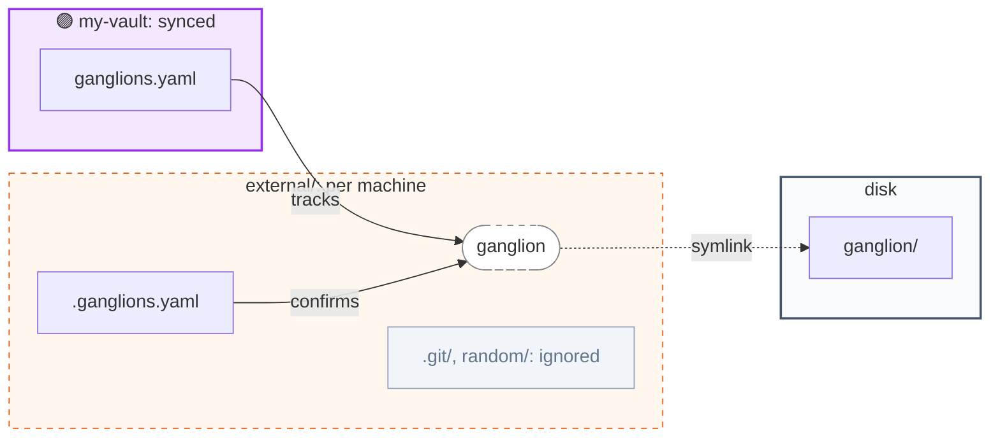

# Registry

## Optional

- a convenience: knowing, from Obsidian, which ganglions a vault has
- never required: a ganglion works with no registry and no plugin
  - link it into `external/`, or keep it anywhere on disk
  - reference it with a plain relative link, as before
- nothing breaks when the files are missing: there is just nothing to show



## Two files

- `<vault>/ganglions.yaml`: the **source of truth**, synced with the vault
  - the ganglions this vault tracks
  - tracked is not present: a machine may lack any of them
  - at the root, not in the plugin's `data.json`: synced with the notes,
    read by `just`, kept when the plugin goes
  - `external:` moves `external/`, from the vault's root; links written
    `../external/…` do not follow it
- `external/.ganglions.yaml`: the **register of this machine**
  - which entries of `external/` are confirmed ganglions
  - **excludes by default**: `.git/`, a random folder, a stray link
  - excluded is not broken: a link to it still opens
  - hidden: a scan of `external/` skips it with every dot entry

```yaml
# <vault>/ganglions.yaml
external: ../external     # optional: the default
ganglions:
  - name: ganglion        # its entry in external/
    source: <git url>     # optional: shown, never fetched
```

```yaml
# external/.ganglions.yaml
ganglions:
  - ganglion
```

- the door is the ganglion's own: `door` in its `ganglion.yaml`, else
  `README.md`
- one entry per line, sorted: clean merges when the vault syncs
- the register is line-based on purpose: `ganglion.just` edits it in bash,
  without `yq`
- a file that is not valid YAML stops the plugin, never gets rewritten

## States

| State | Vault | Register | `external/` |
| --- | --- | --- | --- |
| ✅ ready | yes | yes | an entry that resolves |
| 💤 absent here | yes | any | nothing |
| 💔 broken | yes | yes | a dangling link |
| ❔ unconfirmed | yes | no | an entry |
| ➕ candidate | no | any | a visible entry that resolves |

- `external/` is shared by every vault in the same folder: the register
  belongs to the machine, not to one vault
- a **candidate** is any entry not starting with `.`
  - with `ganglion.yaml`: likely a ganglion, listed first
  - without: likely foreign, the person decides

## Plugin

- a ribbon icon opens a menu of *Open* and *Register*
- **Open ganglion**, a command
  - the tracked ganglions and their state; picking one opens its door
  - probes each tracked name in `external/`: nothing is listed
  - picking an unconfirmed one confirms it
- **Register ganglion**, a command
  - *external/*: lists it, one level, then tracks and confirms the pick
  - *disk*: a folder, typed or browsed; the folder or its `ganglion/`
    is linked into `external/`, then tracked and confirmed
  - the name: `name` in its `ganglion.yaml`, else the folder's
  - an entry already there under that name is kept, never replaced
- **Insert from ganglion**, a command and the editor's context menu
  - pick a ganglion, then how to link it, at the cursor:
  - *Door*: `[name](…/README.md)`
  - *Tree*: its `.md` notes as a nested list of links, levels asked, 0 for
    all; a folder without a note is left out
  - *Find*: a fuzzy search over its notes, one link
  - links are relative to the note's folder, as the plugin opens them

## Just

- `just ganglion install` links the ganglion, confirms it, and tracks it
  in the vault's `ganglions.yaml` when the line is not there yet
- `just ganglion uninstall` removes the link and the confirmation; the
  vault keeps tracking it, for the other machines
- `just ganglion` shows whether it is confirmed, and writes nothing
